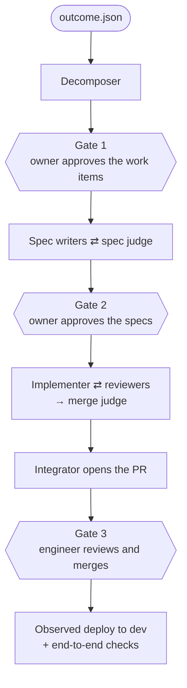

# factory_agents

A **software factory** built on Claude Managed Agents, with people deciding at three gates. It takes a business outcome written in plain terms and ends with reviewed pull requests, then watches the platform deploy them to dev. A deterministic Python controller runs the pipeline. Agents work in separate sandboxed sessions and coordinate only through schema-validated files. Checks that no agent can override sit between every stage.



Each box is its own agent session. Every arrow passes a JSON artifact through the controller, which validates it and runs deterministic checks before the next stage starts. Judges never share a session with the authors they grade. No agent deploys or touches infrastructure. [docs/00-overview.md](docs/00-overview.md) explains the reasoning.

## Status (2026-10-10)

- **It has run live.** Real runs went from an outcome to a pull request on personal GitHub repositories: [factory-sample-app#1](https://github.com/willtech3/factory-sample-app/pull/1) (merged) and [factory-switchboard#2](https://github.com/willtech3/factory-switchboard/pull/2). Hosted verification and app onboarding have also run against real apps. Findings from those runs are in the [post-mortem](docs/postmortems/2026-10-10-first-live-runs.md).
- **Not yet proven live:** the dev-deploy stage (the personal setup has no dev environment), the Linear and GitLab integrations, and the security reviewer (its agent is registered in `claude-lock.json`, but no security pass has run live yet). Jira and eval-driving are stubs.

[docs/repo-map.md](docs/repo-map.md) has the full status table.

## Repository layout

| Path | What |
|---|---|
| [`orchestrator/`](orchestrator/) | **The running code.** The Python controller, the `factory` CLI, and the Factory Console (web UI) |
| [`agents/`](agents/) | One Managed Agents definition per role, deployed with `ant apply` (IDs in `claude-lock.json`) |
| [`environments/`](environments/) | The sandbox definition every agent session runs in |
| [`schemas/`](schemas/) | JSON Schema for every artifact the stages hand each other |
| [`rubrics/`](rubrics/) | The criteria the judges score against |
| [`skills/platform-contract/`](skills/platform-contract/) | What the deployment platform provides and requires, uploaded to every agent |
| [`templates/`](templates/) | The PR description template and the preview workflow seeded into new repositories |
| [`examples/`](examples/) | Outcomes to start runs from (`sample-app`, `switchboard`) and test fixtures (`ledgerline`) |
| [`evals/`](evals/) | The evaluation plan, datasets, graders, and a reference run |
| [`docs/`](docs/) | Design, setup guides, decisions (ADRs), research, post-mortems |

[docs/repo-map.md](docs/repo-map.md) covers which module does what, how the pieces connect, where each piece executes, and which code is live, stubbed, or unused.

## Quick start

```bash
cd orchestrator
python3 -m venv .venv && .venv/bin/pip install -e ".[dev]"
.venv/bin/pytest -q -m "not network"      # no API key needed; drop -m to include the one package-install test
.venv/bin/factory web                     # Factory Console at http://127.0.0.1:8765/
```

To run real agents, put `ANTHROPIC_API_KEY` (and `ANTHROPIC_WORKSPACE_ID` if your key is not scoped to a workspace) in `.env` at the repository root. Then start a **design run** from the Console's Outcomes page. A design run goes through Gate 2 with no repository. You can also start one from a terminal:

```bash
.venv/bin/factory doctor                                            # what is configured and what is missing
.venv/bin/factory run ../examples/sample-app/outcome.json --design-only
```

A full run that opens pull requests also needs a GitHub token and a target repository. Follow [docs/07-personal-e2e-setup.md](docs/07-personal-e2e-setup.md). To change the agents, edit `agents/*.md` and run `ant apply`, as described in [agents/README.md](agents/README.md).

## Docs

| If you want... | Read |
|---|---|
| The whole shape on one page | [00-overview.md](docs/00-overview.md) |
| What code lives where, and what is live | [repo-map.md](docs/repo-map.md) |
| How a run moves, stage by stage, with budgets and failure handling | [01-pipeline.md](docs/01-pipeline.md) |
| What each agent does and why | [02-agents.md](docs/02-agents.md), [agents/README.md](agents/README.md) |
| What a person sees at each gate | [03-human-in-the-loop-ux.md](docs/03-human-in-the-loop-ux.md), [08-factory-console.md](docs/08-factory-console.md) |
| How to design and extend the Console UI | [console-design-system.md](docs/console-design-system.md) |
| How it maps onto Managed Agents | [04-managed-agents-mapping.md](docs/04-managed-agents-mapping.md) |
| Preview environments, the dev deploy, and the platform boundary | [05-platform-and-deployment.md](docs/05-platform-and-deployment.md) |
| Running it with your own GitHub repository | [07-personal-e2e-setup.md](docs/07-personal-e2e-setup.md) |
| Onboarding an app for hosted verification | [09-app-onboarding.md](docs/09-app-onboarding.md) |
| Evaluation | [06-evaluation.md](docs/06-evaluation.md), [evals/README.md](evals/README.md) |
| Decisions and the evidence behind them | [adr/](docs/adr/), [design-principles.md](docs/design-principles.md), [research/](docs/research/) |
| What to build next | [roadmap.md](docs/roadmap.md) |
