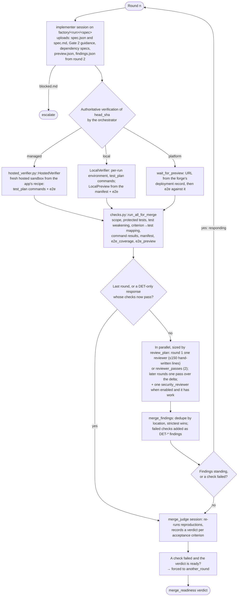

# Pipeline mechanics

This document describes what happens between a human submitting an outcome and the merged change running in `dev`. The orchestrator in `orchestrator/factory/` implements it; `state.py` holds the legal transitions. The deployment platform (CI templates on GitHub Actions or GitLab CI, per-branch preview environments, the `dev` target) is assumed to exist and is described in [05-platform-and-deployment.md](05-platform-and-deployment.md).

## Vocabulary

| Term | Meaning |
|---|---|
| **Outcome** | The human-written business goal with success metrics and constraints. `schemas/outcome.schema.json`. |
| **Run** | One outcome's journey through the factory. Identified by `run_id`; all state is an append-only event log. |
| **Work item** | One node of the decomposition DAG: a feature, task, workflow, agent, spike, or migration. |
| **Spec** | The contract for one work item: acceptance criteria (each flagged `user_visible`), interfaces, allowed paths, test plan including `e2e` checks that run against a deployed instance. |
| **Preview environment** | The per-branch deployment the platform's CI creates for every branch. The end-to-end surface for implementer, reviewer, and the orchestrator's verification. |
| **Platform contract** | The skill (owned by the platform team; `skills/platform-contract/SKILL.md` is a placeholder) that says what the platform provides, what the app must define (a service manifest at a fixed path), and what agents must never touch. |
| **Stage session** | One Managed Agents session with one agent, one job, its own context and budget. |
| **Gate** | A point where a human decision is required before the run continues. Bound to artifact hashes. Read on an artifact page; decided on the gate surface (the Factory Console, the CLI, or the tracker; [ADR-0007](adr/0007-pluggable-gate-surfaces.md)). Nothing reaches the target repository before Gate 3 ([ADR-0011](adr/0011-no-design-change-requests.md)). |
| **Change request (CR)** | A GitHub pull request or a GitLab merge request; the forge is pluggable ([ADR-0008](adr/0008-pluggable-forge-github-default.md)). |
| **Deterministic check** | A computation the orchestrator performs that no agent can override. |

**Security pass.** Beside the general adversarial passes, one Security reviewer session (Fable 5.1) reviews the same diff for trust boundaries, attacker-controlled input, authorisation, secrets and dependencies, with the orchestrator's deterministic pre-checks (`security_prechecks.json`: secret scan over the added lines, dependency audit and SAST when the host has the tools) as inputs. Its findings merge with the others, tagged `pass: security`; a committed credential is a merge check (`secret_scan`) nobody can override; a reproduced security, concurrency or data-integrity finding stands whatever severity it was given. `FACTORY_SECURITY_REVIEW=0` turns the pass off.

## The path of a run

Two processes carry a run. `factory run` (`runner.run`; the Console starts the same command) drives it from intake until every approved spec has a change request, and records `run.completed`. `factory watch` (`watcher.py`; the Console's **Watch** button) takes over from there: it follows each change request through human review and merge, then observes the deploy to `dev`. So a `completed` run has not necessarily merged or deployed anything. Each node names the function that does the step; paths are relative to `orchestrator/factory/`.

```mermaid
flowchart TD
  start(["Console: Start a run / Request a change<br/>or factory run outcome.json"]) --> bind{"Target repository is an onboarded app?<br/>onboarding.binding_for"}
  bind -- "yes" --> managed["Preview mode forced to managed,<br/>bound to the app's verified recipe and test vaults"]
  bind -- "no, a new repository, or design-only" --> asis["Preview mode as configured<br/>(local or platform)"]
  managed --> intake
  asis --> intake
  intake["Stage 0 · runner.run<br/>run.created, intake/outcome.json,<br/>tracker registration when Linear is configured"] --> dec

  subgraph S1["Stage 1 + Gate 1 · runner._from_decompose"]
    dec["stages/decompose.py::run_decompose<br/>decomposer session, outcome grader ≤ 4 iterations,<br/>codebase_researcher threads, ask_human"] --> dchk["Deterministic checks:<br/>schema, DAG acyclic, metric coverage"]
    dchk --> g1page["gate_1.html rendered; Gate 1 opens on the surface,<br/>bound to the artifact sha256s"]
    g1page --> g1{"Owner decides"}
    g1 -- "request_changes<br/>(feedback.md, revision + 1)" --> dec
  end
  g1 -- "reject" --> closed(["closed"])
  g1 -- "approve (+ notes per work item)" --> sw

  subgraph S2["Stage 2 + Gate 2 · runner._from_specify"]
    sw["stages/specify.py::run_specify<br/>spec_writer sessions in parallel (≤ 8),<br/>each sees the whole decomposition"] --> schk["Checks: schema, traceability, e2e_coverage<br/>(failures become blocking issues)"]
    schk --> judge["One spec_judge session over the whole set"]
    judge -- "revise: only the affected specs, ≤ 3 rounds" --> sw
    judge -- "pass, escalate, or rounds used up" --> g2page["specify/final-&lt;spec&gt;.json stored, gate_2.html rendered;<br/>Gate 2 (or the escalation gate) opens"]
    g2page --> g2{"Owner decides"}
    g2 -- "request_changes<br/>(notes routed per spec)" --> sw
  end
  g2 -- "reject" --> closed
  g2 -- "approve / approve_subset<br/>(must include every prerequisite)" --> rec["runner.record_approval<br/>gate_2/approval-&lt;gate&gt;.json:<br/>approved spec hashes + owner guidance"]
  rec --> design{"design-only?"}
  design -- "yes" --> done1(["completed; no repository touched"])
  design -- "no" --> waves

  subgraph S34["Stages 3–4 · runner.implement_and_integrate"]
    waves["Specs whose dependencies have a change request,<br/>up to parallel_implementations per pass, one after another.<br/>Base: default branch, or the dependency's branch<br/>while its change request is open (runner.base_branch_for)"] --> impl["stages/implement.py::run_implement_one<br/>(next diagram)"]
    impl --> mj{"Merge judge verdict"}
    mj -- "another_round, escalate, or blocked.md" --> esc(["run.escalated for that spec"])
    mj -- "ready" --> integ["stages/integrate.py::run_integrate<br/>head must equal the judged sha; no extra commit.<br/>run record stored; description rendered from cr_template.md<br/>and linted; the integrator sends it with open_change_request"]
    integ --> pr["The orchestrator's tool handler checks the branches<br/>and opens the change request with its own token<br/>→ cr.opened, item cr_open"]
  end
  pr --> runDone(["run.completed<br/>(every approved spec has a change request)"])

  subgraph S5["Gate 3 + Stage 5 · factory watch (watcher.py)"]
    watch["Poll each open change request through the Forge protocol"] --> g3{"Human code review on the forge"}
    g3 -- "closed" --> wclosed(["item closed"])
    g3 -- "merged" --> dep["stages/deploy_observe.py<br/>find the pipeline for the merge commit, wait for the dev deploy,<br/>run the spec's e2e entries against the dev URL"]
    dep -- "passed" --> dev(["deployed_dev"])
    dep -- "pipeline or e2e failed" --> df{"DEPLOY_FAILURE gate"}
    df -- "request_changes" --> reimpl(["back to implementing on a fresh branch"])
    df -- "approve: the platform's fault" --> dep
    df -- "reject" --> wclosed
  end
  pr -.-> watch
```



### One spec through Stage 3

`run_implement_one` loops implementer rounds until nothing stands, then runs the merge judge once. Rounds 1 to `review_max_rounds` (2) are each reviewed; round 3 is the implementer's last response and goes straight to the judge.



## Stage by stage

### Stage 0: Intake
A human writes `outcome.json` (a form in the Factory Console, or a file). Required: statement, at least one success metric with a target, constraints (`must_not`, budget), the target repository, and an owner handle. The orchestrator validates the schema and opens the run.

### Stage 1: Decompose
One `decomposer` session, kicked off with `user.define_outcome` and `rubrics/decomposition.md`. The platform's outcome grader iterates the agent up to 4 times until the rubric is satisfied. The decomposer delegates factual questions about the codebase to goal-blind `codebase_researcher` threads so that research records what *is*, not what would justify the plan.

The decomposer may call `ask_human` for a **blocking** question. The session idles; the orchestrator surfaces the question (Console, Slack, email), waits for an answer, and returns it as the tool result. Non-blocking questions return their default immediately and are listed for the human at Gate 1.

The decomposer decomposes only as much as reviewability needs: one work item when the outcome is one coherent change a reviewer can approve as a single pull request, more only where parts must be approved or landed separately or an item would exceed size M, and never items that are not changes to the product (investigations, baselines, documentation riders). Rubric D2 scores this.

Outputs: `decomposition.json`, `decomposition.md`. Deterministic checks: schema, DAG acyclic, every success metric covered or explicitly marked not movable by code, and `size_budget` (no item estimated above size M; see **Size** below). One automatic retry on failure, then escalation.

### Gate 1: Decomposition review
The orchestrator renders `gate_1.html` (summary, metric coverage, work-item table, open questions, the full markdown, the artifact hashes) and opens the gate on the configured surface: a comment with the summary, links, and sha256 list on the run's tracker issue when Linear is configured, otherwise in the Factory Console and the CLI's file queue. The owner reads the summary (under 150 lines), the work-item table, coverage, out-of-scope, and open questions. Decision options: approve, request changes (comments, from the Console, the CLI, or the tracker, become `feedback.md` for a re-run with `revision + 1`), reject (closes the run).

**Pre-approval (benchmark and evaluation runs only).** A bench run started from the CLI can pre-approve Gates 1 and 2 (`FACTORY_AUTO_APPROVE=gate_1,gate_2`), as [post-mortem](postmortems/2026-10-10-first-live-runs.md) issue 20 proposed for scripted bench runs. A pre-approved gate still opens, with its page and hashes, and is approved at once by `policy` only when nothing in it needs a person: Gate 1 with no blocking question; Gate 2 with a passing verdict, no blocking issue and no blocking question in any spec. Anything else waits as usual. It is deliberately not offered in the Console: the practitioner evidence puts the human's highest-leverage review at design and contracts ([practitioners.md](research/practitioners.md) §1c, §1f; [academic-2026.md](research/academic-2026.md) §6, Choudhuri et al.), a passing verdict is one judge call ([academic-2026.md](research/academic-2026.md) §1, Yagubyan), and the [roadmap](roadmap.md) defers automatic approval of real runs until there is gate telemetry. Policy decisions are recorded as `decided_by: policy`, so bench runs start that telemetry.

### Stage 2: Specify
One `spec_writer` session per work item with `rubrics/spec.md` as its outcome rubric, all at once (`Policy.parallel_spec_writers`, default 8). Each writer gets the whole decomposition so it knows what its siblings will do; interface mismatches between siblings are the judge's job to catch and route back, which is cheaper than serialising writers along the dependency chain (`Policy.spec_waves` restores waves). Then **one** `spec_judge` session receives the entire set, normalised to JSON (no prose rendering, so formatting cannot bias it), plus the rubric, outcome, and decomposition. It scores every criterion per spec with evidence and judges set-level coherence: interface mismatches, overlaps, gaps, ordering, contradictions, and a goal-coverage matrix mapping each success metric to the acceptance criteria that move it.

Verdict `pass` goes to Gate 2. `revise` routes issues back to the owning specs only (unchanged specs are not rewritten) for up to 3 rounds. A re-judgement (a later round, or the first round after a Gate 2 send-back) gets `changes/<spec_id>.diff` for every spec that changed since the verdict it revises, the list of specs that did not, and the instruction to re-score only what a change touches, what scored below 2 and the issues it raised, carrying every other score forward ([post-mortem](postmortems/2026-10-10-first-live-runs.md) issue 9). `escalate`, or 3 rounds without a pass, opens an escalation gate with the judge's summary; the human can send the run back to decomposition.

Deterministic checks before the judge spends tokens: schema validity, traceability to the decomposition, `size_budget` (the spec's `estimated_lines` is at size M or below and matches `estimated_size`), `criteria_describe_product` (no criterion names the factory's evidence protocol; a criterion is product behaviour, rubric S13), and `e2e_coverage` (every `user_visible` criterion has a `test_plan.e2e` entry). Failures are injected into the verdict as blocking issues. The judge additionally scores S11 (deployable through the platform contract; manifest present and valid), S12 (end-to-end coverage, with honest `user_visible` flags) and S13 (criteria describe the product a user, operator or caller observes, not the evidence that proves it; [post-mortem 2026-10-11](postmortems/2026-10-11-evergreen-frontier-models-pr.md) §2).

### Gate 2: Specification readiness
`gate_2.html` is rendered (judge summary first, goal-coverage matrix, a section per spec, open questions, hashes) and the gate opens on the surface. The owner sees the judge's `summary_for_human` first, then the goal-coverage matrix, then per-spec issues. Options: approve all, approve a subset, request changes, reject. Only a subset's selected specs are built, and the selection must include every prerequisite the gate presented. The Console, `factory decide` and the runner all refuse a selection that leaves one out. The specs left out are not built in this run and are not sent back to a writer; request changes to have them revised. Approval marks each spec `SPEC_APPROVED` and binds the decision to the artifact hashes. The owner's approval notes travel to the implementers as bounded per-spec guidance (`gate_2/approval-<gate_id>.json`, which also records the approved spec hashes). The notes never change a spec, and a resumed implementation refuses a spec whose bytes differ from what was approved.

### Stage 3: Implement, review, judge (per spec)
Specs are scheduled in dependency waves; each pass takes up to `parallel_implementations` ready specs and implements them one after another, each on its own branch `factory/<run_id>/<spec_id>` cut from the default branch (or from the dependency's branch when stacked).

1. **Implementer** session, outcome rubric `rubrics/implementation.md`. Gets the repository the forge's way (GitHub: mounted at `/workspace/repo` through the native `github_repository` resource, token injected by Anthropic's git proxy; GitLab: clones with the vault credential of ADR-0003), works in vertical slices with a test checkpoint each, commits per slice with the criteria covered, pushes. The push triggers the platform's pipeline, which deploys the branch to its preview environment; the session's `preview.json` (read by the orchestrator from the forge's workflow-run and deployment records) carries the URL, and the implementer must run every `test_plan.e2e` entry against it and record the results. Writes `implementation_report.json`. May write `blocked.md` instead, which escalates.
2. **Authoritative verification** by the orchestrator (in production: a CI job on the branch): checkout `head_sha`, build the per-run virtual environment from the repository (the manifest's `runtime.setup`, else `pyproject.toml`; the check `verification_setup`), run `test_plan.commands` in it (each command in its own process group, killed when it ends), compute the diff, read the preview URL for `head_sha` from the forge's deployment record (the platform's CI deploys the factory branch and records the Deployment; the orchestrator never derives the URL from an agent's report) or, with `FACTORY_PREVIEW=local`, start the service from the manifest entrypoint itself, run `test_plan.e2e` against it (`LocalVerifier.run_e2e`), and run the deterministic checks (scope, protected tests, test weakening, criterion-to-test mapping, command results, `e2e_coverage`, `manifest_valid`, `e2e_preview`, `factory_proof_in_diff`, `size_budget`). An e2e entry that could not run counts as failed. Results are stored and later handed to the merge judge verbatim. With `FACTORY_PREVIEW=managed` all of it runs in a hosted sandbox, and a UI criterion's `factory:journey <name>` entry runs the factory's own browser runner on the journey the implementer wrote as a run artifact, bound by its sha256; no browser-test code enters the change ([05-platform-and-deployment.md](05-platform-and-deployment.md#visual-browser-verification)). The hosted session only runs the harness, so it runs on a small model at low effort (`FACTORY_VERIFY_MODEL`, default `claude-haiku-5-5:low`; `agent` keeps the implementer's).
3. **Reviewer**: independent `reviewer` sessions, each a fresh context, sized by `review_plan`: one pass when the change is at most `review_single_pass_lines` (default 150) hand-written lines, else `reviewer_passes` (default 2); the security pass beside them in round 1. Each receives spec, diff, implementation report (as hypotheses), `preview.json`, the platform-contract skill, and the branch. Each runs the preview e2e entries itself and probes the deployed instance (in local mode: an instance it starts from the manifest entrypoint, since the orchestrator's is `unreachable_from_sandbox`); a `user_visible` criterion it could not exercise at all is `not_assessed`. Findings are merged and de-duplicated by location, strictest severity wins. Each finding has a claim, evidence with reproduction, the criterion it violates, and a refutation condition.
4. If any blocking or major finding stands, or a deterministic check failed: **Implementer** again (a new session on the same branch) with `findings.json`. It must answer every finding: `fixed` with commit and test, `refuted` with evidence meeting the refutation condition, or `accepted_risk` for a human to decide. Back to step 2. When the only standing findings are the orchestrator's own `DET-*` checks (no reviewer finding is blocking or major), the re-verification of the response goes straight to step 6 if the checks pass: a fresh review would only re-prove round one. A `DET-*` finding whose output blames the host (a port already in use) is tagged `environmental`.
5. Round 2 review is `reviewer_passes_followup` (default 1) **new** reviewer session that receives the previous findings and the response, judges each response against the refutation condition (`upheld` / `withdrawn`), then reviews `delta.patch`, the commits since the head the previous round reviewed (the whole diff stays as context; new findings only on what the delta changes or breaks). The security pass returns only when one of its findings still stands or the delta's secret scan flags a line. Two full passes in round 2 of live run 2 re-proved the same four withdrawals ([post-mortem](postmortems/2026-10-10-first-live-runs.md) issue 10). Default `review_max_rounds = 2`; more rounds raise false positives faster than recall ([academic-2026.md §2](research/academic-2026.md), Song).
6. **Merge judge**: one independent session with spec, diff, findings, responses, the orchestrator's test results and deterministic checks. Re-runs reproductions itself, and records its own verdict per acceptance criterion in `merge_readiness.criteria` from evidence it located (the orchestrator's e2e rows for `user_visible` criteria). Decides `ready`, `another_round` (with exactly what to do), or `escalate`. A failing deterministic check forces `another_round` regardless of what the judge writes.

### Stage 4: Integrate
The orchestrator retains the approved specification, spec judge verdict, merge judge verdict, and verification evidence in Factory’s artifact store. Integration makes no repository commit: the PR head is the exact candidate verified and judged. Before the integrator starts, the orchestrator writes the spec's **run record** (`run_record.py`, `integrate/<spec_id>-run_record.json`): the acceptance criteria with the judge's evidence and the covering e2e rows, every review finding and how it settled, the deterministic checks and the verification environment, every screenshot and recording with its step observations, the judge's residual risks and full summary, and provenance with per-session cost. The Console's run page shows it.

The change request itself is written for an engineer who knows the app and nothing about the factory ([post-mortem 2026-10-11](postmortems/2026-10-11-evergreen-frontier-models-pr.md) §4). The orchestrator renders it from `templates/cr_template.md` (`pr_description.py`): what changed and why (the merge judge's `pr_summary`), what needs the reviewer's decision (product-affecting items first, each with `file:line`), up to three screenshots and one demo when there is a UI (published outside the diff, [ADR-0012](adr/0012-pr-media-without-media-in-the-diff.md)), how it was tested (counted from the orchestrator's own results, plus the commands to run locally), the size split into hand-written and generated lines with any over-budget flag, at most three files to start reading at, and one link to the run record. When the draft passes its lint the orchestrator opens the change request itself, through the same `open_change_request` handler; only a draft the lint refuses goes to an `integrator` session, which rephrases what the lint names and calls that tool. Either way the orchestrator lints the description before the forge sees it (at most 60 lines; no tables, factory ids or vocabulary, agent or session names, costs, first-person text, or links to the owner's machine other than the run record) and refuses it with the reasons otherwise; then it opens the change request with its own forge token, applies labels and requests reviewers. An evaluation copy gets a one-sentence do-not-merge banner and the files and lines it holds beyond the current default branch.

### Gate 3: Human code review
Ordinary pull-request or merge-request review on the forge. The factory never merges. The change-request watcher (`factory watch <run_id>`, `orchestrator/factory/watcher.py`; the Console's **Watch** button starts the same process) polls each open change request through the `Forge` protocol and records `cr.merged` (with the merge commit) or `cr.closed`; a merge moves the item to `MERGED` and starts Stage 5. The watcher is idempotent across restarts: it re-derives the run from the event log and appends only what is missing. Human review comments on a factory CR can be routed back as a new implementer round (`CR_OPEN -> IMPLEMENTING`), which is how a human steers an almost-right change without taking it over.

### Stage 5: Observed deploy to dev
No agent runs. The platform's own pipeline on the default branch deploys to `dev` with its existing templates, as it would for any merge. The orchestrator (`stages/deploy_observe.py`) moves the work item `MERGED -> DEPLOYING_DEV`, finds the pipeline for the merge commit (a forge webhook may report it first; polling through the `Forge` protocol is the source of truth), and records `deploy.started`, then `deploy.succeeded` or `deploy.failed` with a log excerpt. On success it reads the dev URL from the `dev` deployment or environment record, runs the spec's `test_plan.e2e` entries plus an optional smoke suite against it, and records `e2e.dev_passed` or `e2e.dev_failed`. Success ends the work item at `DEPLOYED_DEV`.

Any failure opens a `DEPLOY_FAILURE` gate carrying the pipeline or e2e log excerpt. Options: `request_changes` routes the item back to `IMPLEMENTING` on a fresh branch with the comments as the first finding (a follow-up change request, not a revert); `approve` says the failure was the platform's and the next pipeline is watched once more; `reject` closes the item. Promotion beyond `dev` is a human act outside the factory. Rationale and evidence: [05-platform-and-deployment.md](05-platform-and-deployment.md), [ADR-0006](adr/0006-observed-deployment-not-agent-driven.md).

## Run-level state

```
intake ─► decomposing ─► gate_1 ─► specifying ─► gate_2 ─► implementing ─► completed
             │  ▲          │ changes  │  ▲          │ changes      │
             │  └──────────┘          │  └──────────┘              ├─► escalated ─► (back to a stage | closed)
             │                        │ reject                     ├─► paused_budget ─► (resume | closed)
             └─► escalated            └─► closed                   └─► failed
```

Work items have their own state (`pending → spec_drafting → spec_judging → spec_approved → implementing → reviewing → responding → merge_judging → integrating → cr_open → merged → deploying_dev → deployed_dev`, with `blocked`, `escalated`, `closed` side exits; a dependant may start once its upstream is `merged` or later). `state.py` encodes both tables and rejects illegal transitions, so a bug in a stage module cannot put a run into an impossible state.

## Budgets and limits

| Knob | Default | Why |
|---|---|---|
| Run budget | `outcome.constraints.budget_usd`, else $150 | Enforced by the orchestrator before every session (`budget.py`): spent so far (the sum of `session.finished` list costs) plus the caps of the sessions about to start must fit under it, or the run pauses (below). Raised only by a human, from the budget gate or `factory resume --budget`. |
| Stage caps | decompose 4, specify 3, judge 6, implement 15, review 6, security review 6, merge judge 3, integrate 2 (USD, list price; observed p95 x 3 from the first live runs). `FACTORY_BUDGET_SCALE` scales them, never below the stage's observed median (`Policy.stage_budget_floor_usd`). | Every session carries its own hard cap (platform-enforced). A session that hits its cap stops with `budget_reached`; the orchestrator records `budget.reached`, keeps the session's files without using them, and opens a budget gate: approve re-runs the session with the cap raised by half (checked against the run budget first, like any session), reject closes the run. A graded session that exhausts its grader iterations (`max_iterations_reached`) opens the same gate; approve accepts its last output for the judges downstream to check. |
| Outcome iterations | 4 | Platform grader loop inside writing sessions. |
| Spec judge rounds | 3 | Then escalate. |
| Review rounds | 2 | One fresh review per round. |
| Reviewer passes | 2 above 150 hand-written lines, else 1 (`FACTORY_REVIEWER_PASSES`, `FACTORY_REVIEW_SINGLE_PASS_LINES`); 1 over the delta in later rounds (`FACTORY_REVIEWER_PASSES_FOLLOWUP`) | Independent copies, merged. A second pass found complementary defects on a large diff and only re-proved the first on small ones. |
| Gate pre-approval | off; bench and evaluation runs only (`FACTORY_AUTO_APPROVE=gate_1,gate_2` or `all`, not in the Console) | A listed gate approves itself only when nothing in it needs a person; see Gate 1. |
| Verification model | `claude-haiku-5-5:low` (`FACTORY_VERIFY_MODEL`; `agent` keeps the implementer's) | The hosted verification session only runs the harness. |
| Parallel implementations | 3 | Ready specs taken per scheduling pass; they are implemented one after another, on separate branches, and merge serially via Gate 3. |
| Preview wait | 30 min | How long authoritative verification waits for the platform's pipeline to deploy `head_sha` to its preview before `e2e_preview` fails closed. |
| Dev pipeline timeout | 60 min | Stage 5: how long the orchestrator watches the dev pipeline before opening a `DEPLOY_FAILURE` gate. |
| Size budget | XS ≤ 50, S ≤ 150, M ≤ 400 hand-written lines | `FACTORY_SIZE_BUDGET` (`Policy.size_budget_lines`). See **Size**. |

## Size

A change's size is its hand-written changed lines (added plus removed), tests included. Generated files are excluded: a path git reports as `linguist-generated` at the head (`git check-attr`, so nested `.gitattributes` files count), a lockfile, or a path the spec declares in `regenerated` with the command that rewrites it (`orchestrator/factory/size.py`; [post-mortem 2026-10-11](postmortems/2026-10-11-evergreen-frontier-models-pr.md) §3). The budget is enforced when planning: the decomposer gives every item `estimated_lines` and splits anything above M, putting a refresh that rewrites a large generated file in its own item that lands first unless it is small; the spec writer estimates again and the spec judge (rubric S5) and the `size_budget` pre-check reject a spec above M. At merge, the `size_budget` check reports hand-written lines (app and tests) and generated lines against the spec's estimate. Going over budget is a flag shown in the run record and in the pull request's size line ("N hand-written lines (app X, tests Y); G generated lines in <files>, regenerated by `<command>`"); the check always passes, so it never triggers another round. App onboarding lists the generated files it finds and asks the owner to mark them `linguist-generated`; existing-app onboarding cannot write `.gitattributes`, so it states the lines to add as a limitation instead.

## Failure handling

- **Session error or `retries_exhausted`:** the stage is retried once with the same inputs; then escalation.
- **Schema-invalid artifact:** the sandbox validator catches most; the orchestrator re-validates with full `jsonschema` and treats failure like a deterministic check failure.
- **`blocked.md`:** implementer could not proceed without changing scope or resolving a spec conflict. Escalation gate with the file's content; the human can send the spec back to the writer.
- **Non-convergence:** same finding across two rounds, or judge `escalate`. Escalation gate with the exchange summarised.
- **Budget:** before a stage starts a session (or a batch of parallel sessions: the spec writers, the reviewer passes), it checks spent plus the caps it is about to commit against the run budget. When the next step would not fit, nothing starts: the run moves to `paused_budget` (`budget.reached`, with the numbers in `artifacts/budget/paused-N.json`), a **budget gate** opens on the gate surface bound to that file, and the orchestrator exits cleanly with nothing in flight. The owner approves the gate with the new cap (`budget_usd: 80` in the comment; a number input in the Console) or rejects it to close the run; `factory resume <run_id>` (or `--budget N` / `--outcome file.json`, which is the decision by itself) records `gate.decided` and `budget.raised` and re-enters the stage the check interrupted: implementation continues from its artefacts (`resume_points`), decomposition and specification re-run from the start of the stage with the owner's last gate feedback. The check is cap-based on purpose: a session may spend up to its cap, so this is the only arithmetic that guarantees the run never exceeds the budget; it is conservative, and a step usually costs less than its cap.
- **Controller stopped while idle at Gate 2:** for example, to move a run to a newer controller with managed (hosted) verification before anyone approves implementation. Stopping the controller with SIGTERM records `run.failed`. `factory resume <run_id>` then continues the same run at that same gate. It does not regenerate the specs or reopen the gate. Before anything is written, `runner.pending_gate2` checks the following:
  - the last gate is the run's only open Gate 2 (specification readiness or escalation), still undecided;
  - nothing but idle stops and earlier recoveries of that gate follow it;
  - every presented artefact (`specify/final-<spec_id>.json`, `judge/final-verdict.json`) still has exactly the sha256 the gate showed;
  - the gate surface's record matches the logged `gate.opened`.

  The resumed controller records `run.resumed` with the gate, its hashes and the preview configuration. It waits for the owner's decision, which the surface validates against those hashes as always, and runs no agent until then. approve, approve_subset, request_changes (the next specification round, numbered after every stored round) and reject then follow the usual Gate 2 path. A decided gate, a stop that interrupted a session, a missing or changed artefact, a changed gate record, or a `--budget` change is refused, and the refusal writes nothing. `--preview managed` also needs the approved recipe fingerprint (`--test-profile-sha256`) and valid managed settings. Once a run has been resumed in managed mode, it refuses any later resume without managed mode. Each `factory resume` holds a nonblocking per-run lock (`runs/<run>/controller.lock`) for its whole drive, and a second one is refused. Decisions must come from the Console or `factory decide`, because a tracker queue knows only the gates its own process opened.
- **No preview for the branch:** `preview.json` reports `pending` or `failed`; agents run `local` e2e entries meanwhile, and the orchestrator's `e2e_preview` check fails closed until the platform's pipeline has deployed `head_sha`. A persistent platform failure is a `blocked.md` from the implementer, not something it works around.
- **Dev deploy or dev e2e failure after merge:** `DEPLOY_FAILURE` gate (Stage 5) with the log excerpt; back to `IMPLEMENTING` on a fresh branch, re-observe, or close.

## Why not one coordinator session for the whole run

Managed Agents supports a coordinator with a roster, and it is the right tool *within* a stage (the implementer rostering researchers; the reviewer rostering copies of itself). It is the wrong tool *across* stages: human gates need the run to park for hours or days, judges need context that provably excludes the author's reasoning, each stage wants its own versioned agent and budget, and evals need to run one stage in isolation with frozen inputs. See [ADR-0001](adr/0001-orchestrator-driven-stage-sessions.md).
