# App onboarding and hosted test environments

Open **Apps → Add an app** in Factory Console. Choose an accessible GitHub repository, or describe a new app and pick the account and name of its intended private repository. Choosing a repository that is already an app on this Console links to that app and asks before a second one is added. The default onboarding cap is $10. Discovery starts after the form is submitted; verification and publication are separate actions.

The App Onboarding managed agent reads pinned committed source, dependency declarations, existing CI/tests and setup recipes. It proposes a schema-valid plan and asks only unresolved questions. For a new app it proposes a minimal working scaffold. Discovery has no network access, no credentials, and cannot execute the application. An agent proposal is not evidence that the app works.

## The path of an onboarding

`AppOnboarding` (`orchestrator/factory/onboarding.py`) runs each step as a background job on the Console. Discovery is capped at $3 per session and verification at $4, both within the app's budget. Verify and publish refuse to start unless the caller names the current `plan_sha256`, so nobody acts on a plan they have not seen. Each node names the function that does the step.

```mermaid
flowchart TD
  add(["Console: Apps → Add an app<br/>existing GitHub repository, or a description of a new app"]) --> create["AppOnboarding.create<br/>status connected; budget $10 by default, at most $60"]
  create --> disc

  subgraph D["Discover · start('discover') → _discover"]
    disc["Clear the old plan and verification; keep them as previous_attempt.<br/>source(): tarball of a pinned commit from GitHub<br/>(a new app gets a README stub)"] --> dsess["app_onboarding session in the shared discovery environment:<br/>no network, no vaults, nothing executed.<br/>Uploads the source and onboarding-request.json<br/>(answers, feedback, previous_attempt)"]
    dsess --> vplan["validate_plan: schema, onboarding recipe paths only,<br/>recipe path = the manifest's test_environment.profile<br/>→ plan + plan_sha256"]
  end
  vplan --> q{"Required questions unanswered?"}
  q -- "yes: needs_input" --> ans["Owner answers or leaves feedback<br/>(plan_sha256 cleared)"]
  ans --> disc
  q -- "no: setup_ready" --> review["Owner reviews the plan"]
  review --> creds["credential(): one Anthropic vault per secret<br/>the recipe declares, scoped to its allowed hosts"]
  creds --> ver

  subgraph V["Verify · start('verify', plan_sha256) → _verify → test_environments.run_hosted"]
    ver["Guards: plan_sha256 current, required questions answered,<br/>required credentials connected"] --> cand["_candidate: source + the plan's proposed files,<br/>committed in a fresh git snapshot"]
    cand --> env["ensure_environment: reuse the workspace environment<br/>with the same recipe fingerprint, or create one"]
    env --> hsess["Fresh hosted session with the vaults attached;<br/>uploads the source archive, the request<br/>and the sandbox_tools/environment_runner.py harness"]
    hsess --> harness["Harness: prepare → start → health checks → seed<br/>→ verify (browser journeys or functional checks) → stop.<br/>On failure the session writes diagnosis.json"]
    harness --> bindchk{"Controller: bound to head, profile and source hashes?<br/>Every phase passed? Required evidence present?"}
  end
  bindchk -- "no" --> fail["status failed: phases, service readiness,<br/>check rows and diagnosis shown"]
  fail -- "Improve or repair the setup" --> disc
  bindchk -- "yes" --> ready["status ready, or ready_limited when the plan states<br/>limitations or unavailable capabilities.<br/>AppEnvironments.settle labels the environment verified<br/>and archives the app's other environments"]
  ready --> pub

  subgraph P["Publish · start('publish', plan_sha256) → _publish"]
    pub{"Verification still matches<br/>the current plan and source?"} --> files{"Plan proposes files?"}
    files -- "no: an existing recipe is reused" --> nopr(["ready; nothing to publish"])
    files -- "yes" --> branch["Existing app: branch factory/onboarding-&lt;id&gt; from the pinned commit.<br/>New app: create the private repository first, branch from its default branch"]
    branch --> draft["Commit the files and open a draft setup PR<br/>(fingerprints, session, journeys, limitations)"]
  end
  draft --> poll["refresh_setup_pr re-reads the PR state<br/>every few minutes while it is open"]
  poll --> merged(["Owner merges the setup PR"])

  merged --> later(["Later change runs on the repository:<br/>binding_for → run_settings checks the verified recipe is on the base branch,<br/>then forces managed mode with its vaults<br/>→ HostedVerifier in Stage 3"])
  nopr --> later
```

## The reviewed contract

`onboarding_plan.schema.json` describes journeys, planned capabilities, questions, proposed files and limitations. Existing-app changes are confined to onboarding recipe paths; application, CI and security-policy changes require separate work. A recipe can be reused without a new commit or PR. Its path must match the service manifest's `test_environment.profile`, or `test_environment.json` when there is no pointer; a disconnected recipe is rejected before cloud verification. Answering questions invalidates the reviewed plan fingerprint and requires another discovery pass.

`test_environment.schema.json` defines a Linux runtime, prepare/start/seed/verify/stop commands, service health checks, network hosts, declared secret references and one of:

- Browser journeys, required viewports, screenshots and an optional short demo.
- Functional API, worker, CLI or library checks with named observations.

A Slack bot, webhook, worker, CLI or library uses functional checks, not a browser. Hosted browser permission does not make every app a browser test, and the sandbox session is told about browsers only for a browser recipe. The verify command runs a script proposed under `verification/factory-onboarding/`; that baseline is the only browser code an app keeps for the factory, and a later change's browser checks run the factory's own runner on a journey that is a run artifact ([05-platform-and-deployment.md](05-platform-and-deployment.md#visual-browser-verification)). It exercises real behaviour with synthetic inputs, such as signed requests to the running service, the CLI on fixtures or the public API, and writes `verification-result.json` with an observation per check. Nothing in a proposal runs before verification, so discovery installs dependencies the way the repository's CI does. Other lockfiles and scripts can be stale. Services start so that cloud SDK clients need no real credentials, using emulator hosts or fakes the code supports.

The agent also lists committed files that tools write (a data snapshot, a generated client) and that `.gitattributes` does not mark `linguist-generated`, in `generated_files`. For a greenfield app the controller turns them into a question asking the owner to mark them (the next discovery proposes the lines), because a pull request's size budget counts only hand-written lines ([01-pipeline.md](01-pipeline.md#size)). Existing-app onboarding cannot write `.gitattributes`, so there the controller adds a stated limitation with the lines to add in their own small pull request.

Specialized native/mobile/GPU runtimes must report unsupported capabilities. A browser test does not stand in for an unavailable native test. Onboarding cannot promise universal one-click setup: some applications need a test identity, an isolated service or a repository-approved adapter.

## Where execution happens

Factory stores the portable recipe in the repository. It creates or reuses a fingerprinted environment definition in Anthropic Console **Environments**, then creates a fresh hosted session for each verification. A changed or manually altered environment definition is not overwritten. App processes, databases, browser automation and test data stay in that sandbox. The Console may run on the user's computer; it only stages source archives and downloads evidence.

An onboarded app is an execution environment in that workspace: future factory work on the app runs its hosted checks there. The definition is looked up in the workspace by recipe fingerprint, not only in the Console's local cache, so another Console, checkout or worktree reuses it instead of creating a copy. Definitions carry the app's id, name and repository as metadata (`factory_app_id`, `factory_app_name`, `factory_repository`), and discovery uses one shared network-less definition (`factory_purpose: discovery`). When a recipe verifies, its environment is labelled `factory_verified_at` and the app's other definitions (earlier recipes, duplicates) are archived, so a settled app keeps one. An environment a session is running in is never archived.

**Apps** shows each app on this Console once: its onboarding status, its setup pull request (re-read from the forge every few minutes while it is open, so a merged or closed pull request says so), and its execution environment from the workspace. **Elsewhere in the workspace** lists the apps other Consoles onboarded, with leftovers from earlier attempts and a two-step **Archive** for them; each archive is re-checked against a fresh read of the workspace. Definitions created before these labels are grouped by the recipe name in their own name. Apps onboarded elsewhere keep their plan, evidence and test credentials on the Console that onboarded them; **Onboard on this Console** starts onboarding here with the repository filled in, and an unchanged recipe reuses the existing environment. `factory environment prune` prints the same view, and `--yes` archives the leftovers.

The controller uploads an immutable source archive and its own lifecycle harness. The agent runs that harness without editing it or the app. The harness checks readiness, seeds synthetic data, runs checks, captures results and stops services. The controller binds acceptance to source/profile hashes, expected phases and required evidence. Completed sessions are archived. There is no promise of an externally reachable live preview URL; screenshots and recordings are downloaded to the Console.

The original `local` and `platform` verification modes predate this path. Do not use them when the requirement is hosted-only application execution. A passing onboarding baseline alone does not approve future changes or satisfy their acceptance criteria: each candidate still needs current command and visual evidence. Post-merge dev deployment verification is a separate capability: managed runs fail closed until a hosted dev-test adapter is configured, and never fall back to executing those checks on the Console host.

After the setup is committed to the target branch, **Request a change** binds the new run to that app's verified recipe and explicit test vaults. The backend checks the repository and profile fingerprint; browser form fields cannot substitute another repository or unreviewed recipe. Every live start path binds an onboarded repository, not only **Request a change**. A generic **Start a run**, a saved outcome, or `factory run` on a repository an app was onboarded for uses that app's verified setup, resolved and checked on the server. If several apps share the repository, or its app's setup is not verified, the start is refused with the reason instead of running local or platform verification. An explicit `--preview local` or `--preview platform` for it is refused too. Repositories without an onboarded app, new repositories the run creates, and design-only runs start as before. Managed verification runs the candidate's test commands and both `local` and `preview` e2e entries inside a fresh cloud sandbox. Results are bound to the exact source archive, commit, recipe and specification. The baseline and changed-behavior evidence are separate. UI criteria require real per-step screenshots, matching viewports and a controller-issued visual request; `factory:browser` is rejected in hosted mode.

Automated acceptance criteria are proven by the controller's test reports or the actual e2e journey assigned by the approved spec, never by the implementer's claim. pytest commands write JUnit through `PYTEST_ADDOPTS`, and the harness also collects pytest node IDs. A direct `bun test ...` test-plan command runs with the harness's own `--reporter=junit --reporter-outfile` inserted after `bun test`. Its IDs are `path/x.test.ts::outer describe > inner describe > test name`, read from the report's nested suites. Skipped, todo and name-filtered tests count as not passed. A report whose case count disagrees with its declared total is rejected. Bun has no verified collect-only mode, so the report itself is the inventory. Package scripts (`bun run test`), pipelines, environment prefixes, wrappers and commands that choose their own reporter give no Bun evidence, and each such row records the reason. In managed runs, an automated criterion without a matching passing test in a report fails `ac_test_mapping`. The report shape was checked against Bun 1.3.14 and verified in a hosted Evergreen run with all 12 existing model tests passing. An e2e journey itself can be mapped as `e2e:0` (the zero-based entry index in the approved spec). It must name the criterion in `covers_ac` and have a matching passing controller result; a visual entry also needs its exact current browser evidence. A baseline result or a different entry cannot substitute for it.

Inside the sandbox, every e2e command and browser check reaches the recipe's app at `http://localhost:<port>` (`BASE_URL`). That is the origin dev servers and recipes use, and an origin or CSRF check compares the browser's Origin with it. `127.0.0.1` reaches the same socket but is a different origin. Nothing about the check is weakened, and readiness probes still use `127.0.0.1`. An app that accepts only the `127.0.0.1` host name would need its recipe or app to accept `localhost`. When the repository's root `package.json` depends on `next`, the harness sets `NEXT_TURBOPACK_EXPERIMENTAL_USE_SYSTEM_TLS_CERTS=1`, unless the sandbox environment already sets it. That is Next.js 16's documented switch to the system CA roots for Turbopack's external HTTPS (the Google Fonts download): TLS stays verified against the certificates the sandbox already trusts, nothing is installed, and the recipe, app files and spec commands are untouched. The applied defaults are recorded as non-secret `runtime` metadata in the hosted verification record. A plan whose every test command is a Bun command skips pytest collection and says why. Bun's own reports list its tests, so this is not a pytest failure. Completed verification sessions count toward the run's spend exactly once, whatever their result. The managed verifier records its session, phases, sanitized exit results, collected pytest node IDs, per-command test outcomes and browser media. Raw command logs remain in the sandbox to avoid exporting credentials. This limits automatic failure diagnosis; the session link is available for deeper inspection. Controller-side dependency audits and SAST are explicitly skipped in managed mode until they have hosted adapters. No reachable preview deployment is claimed.

## Credentials

Only names declared by the reviewed recipe get write-only inputs. Values go to Anthropic credential vaults and are never persisted in the app record, agent prompt or browser storage. Each declaration has a separate vault scoped to allowed hosts and header/body substitution. A changed scope requires reconnection and old scopes are not attached to new sessions. Forge credentials are never attached to the test environment.

Opaque vault substitution works for supported outbound requests, not local signing or encryption. Generate synthetic JWT/encryption secrets inside the sandbox. Test integrations may require separately scoped provider credentials; a no-key baseline must say what it excludes. Never seed real conversations or production accounts.

## Evidence, budgets and recovery

The app page records every session and its reported cost. A pending session reserves its cap. Missing usage is charged conservatively against the cap, not displayed as free. Controller restart recovery interrupts orphaned remote work before a retry becomes available.

**Improve or repair the setup** sends feedback, the previous proposal and failure evidence back to the onboarding agent. It invalidates the previous plan fingerprint and verification, so a repaired proposal must be verified again before publication. Failed phases are visible without downloading the technical report.

A failed verification names what failed, in harness order: the first failed command and its exit code, or a service that never answered its health check. A start command that backgrounds a process exits 0 even when that process then crashes, so every phase can read passed while a service was never ready. Next come missing credentials, then each functional check that did not pass. Once verify has run, every declared check is shown with its status and the recipe's observation, and a check the recipe never reported reads `not reported`. When the harness exits non-zero, the sandbox session reads the logs and writes a bounded `diagnosis.json`. It names the failing command, the error and the likely cause, never credential values. The Console shows it labelled as commentary, not evidence. Raw logs still stay in the sandbox. The phases, service readiness, check rows and diagnosis go to the next discovery in `previous_attempt.verification`. An agent plan that fails its schema reports the failing paths, never their values, in the error that discovery sees next. A discovery that ends without a plan reports its stop reason and the agent's last message instead, so a denied tool call or an unanswered question in chat is visible. A plan without a runnable recipe stays in needs input even when its questions are answered; Verify needs a recipe.

Readiness means the declared baseline passed, with any limitations shown. It does not mean all features or production authentication were tested. Inspect screenshots and play the recording. The reviewed source and plan fingerprint remain attached to the result. Publishing creates a draft setup PR; it does not merge it. Setup publication, Gate 1 scope, Gate 2 specs and final code merges remain separate decisions.

## Operator setup

Deploy `agents/app_onboarding.md` and register its ID in `claude-lock.json`. When adding only this agent, use a separate lock file with `ant apply` and copy that one confirmed registration into the main lock; review the plan so unrelated agent definitions are not reconciled accidentally. Existing Factory/GitHub credentials remain required for Console source access and draft PR creation.

`factory environment check` validates a committed recipe. `factory environment verify` runs a bounded hosted verification and writes evidence to a fresh output directory. It does not run app commands locally.
