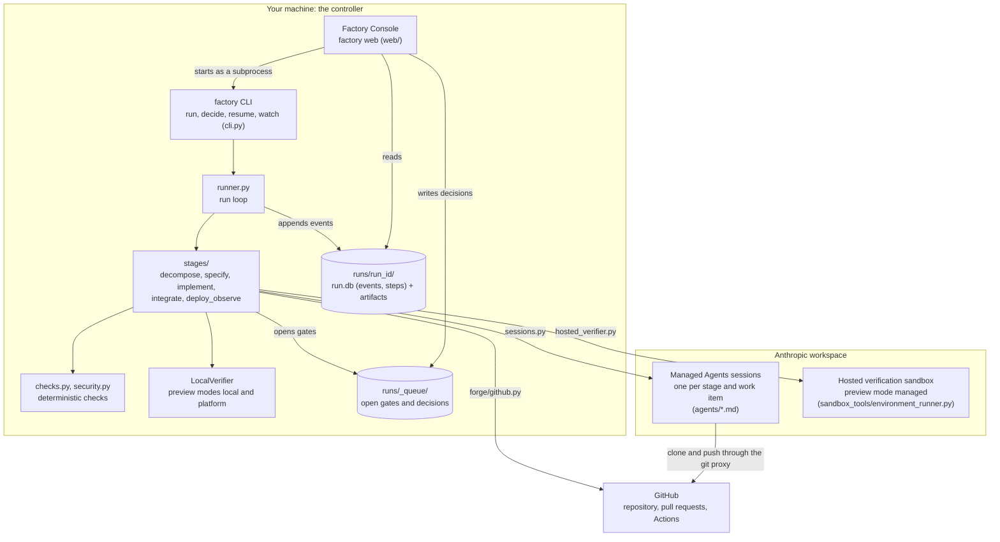

# Repository map

Where things live, what runs, and what is reference material or not wired up. Status is as of 2026-10-12. Update the [status table](#what-runs-and-what-does-not) when something moves between rows, and the module tables when a module is added, removed or renamed. Counts and line numbers are left out on purpose because they go stale.

## Top level

| Path | What it is | Used at runtime? |
|---|---|---|
| `orchestrator/` | The Python controller: the `factory` CLI, the run loop, stages, checks, forge and gate integrations, and the Factory Console | **Yes**. This is the running code |
| `agents/` | One Managed Agents definition per role (YAML frontmatter is the config, the Markdown body is the system prompt), applied with `ant apply` | **Yes**. Deployed to the workspace; IDs pinned in `claude-lock.json` |
| `environments/` | `factory-cloud.yaml`, the sandbox every agent session runs in (allowed hosts, packages) | **Yes**. Applied with the agents |
| `claude-lock.json` | `ant apply`'s record of deployed agent and environment IDs and versions. Commit it | **Yes**. `config.py` reads agent IDs from it |
| `schemas/` | JSON Schema for every artifact passed between stages, plus the onboarding plan and test recipe | **Yes**. Checked by the orchestrator and uploaded to sessions |
| `rubrics/` | Per-criterion 0–3 rubrics used by the judges and the platform's outcome grader | **Yes**. Uploaded to sessions |
| `skills/platform-contract/` | What the deployment platform provides and requires. This version describes the personal-GitHub setup | **Yes**. Uploaded to every session and seeded into repositories the factory creates |
| `skills/security-review/` | The security reviewer's reference: per-stack sink tables and the sources behind its rules | **Yes**. Uploaded to every security review session |
| `templates/` | The PR description template and the GitHub Actions preview workflow seeded into new repositories | **Yes** |
| `examples/` | Outcomes and fixtures (see [Examples](#examples)) | Partly. Some are start points or test fixtures |
| `evals/` | Evaluation plan, dataset specs, graders, a reference run, and the eval receipts that gate changes to the graded roles' prompts and rubrics (`receipts.json`, `gate.py`) | Graders, the replay of recorded sessions and the receipts gate are tested; CI runs `gate.py`. Driving agents over the labelled datasets is a stub |
| `docs/` | Design, setup guides, ADRs, research, and dated audits and post-mortems | No |
| `.github/workflows/ci.yml` | Tests on Python 3.12 and 3.13, the ruff gate, the eval receipts gate (`evals/gate.py`), and the browser runner against a real Chromium | On every pull request |
| `.claude/launch.json` | Starts the Console as a Claude Code preview server | Dev convenience |

Local-only files (git-ignored): `.env` (API key, workspace ID, forge token), `runs/` (every run's event log and artifacts), `evals/recordings/` (recorded sessions, which hold repository content and owners' notes), `evals/results/`, `orchestrator/.venv/`, `orchestrator/shell-shim/` (ignored as a safety net: the verifier's `sh` symlink belongs under each run's verify directory, and `tests/conftest.py` fails any test that leaves it here).

## How the pieces connect

The controller never runs inside the sandbox, and agents never call each other. A stage starts a session, uploads its inputs (artifacts, schemas, rubrics, the platform skill, `sandbox_tools/validate.py`), waits for it to finish, downloads its outputs, validates them, runs the deterministic checks, and appends events. Each session is a durable step that records its session id before anything waits on it, so a controller that dies leaves sessions the next one follows ([ADR-0013](adr/0013-durable-runs.md)). A run's state and status are derived from its events by `state.reduce` and `summary.summarize`, so any run can be replayed (`factory replay`); the Console's Steps card and `factory steps` read the steps table through `projection.project`.

A human decides a gate by writing to the file queue, either from the Console or with `factory decide`. The run process polls the queue and accepts a decision only if it names the same artifact hashes the gate showed ([ADR-0005](adr/0005-gates-bind-to-artifact-hashes.md)).

## Where code executes

| Place | What runs there | Entered through |
|---|---|---|
| Your machine | The Console, `factory run` / `resume` / `watch`, deterministic checks, the app's tests in `local` and `platform` preview modes and its service in `local` mode (`LocalVerifier`, `LocalPreview` in `local_verifier.py`) | `factory` CLI, `factory web` |
| Managed Agents session | One agent role per session, with the repository mounted at `/workspace/repo` | `sessions.SessionDriver` |
| Hosted verification sandbox | In `managed` mode, the app's recipe, its tests and its e2e and browser checks for one candidate commit; also app onboarding verification | `hosted_verifier.py`, `test_environments.run_hosted` |
| GitHub Actions | The target repository's own CI and preview workflow. The factory only reads it | `forge/github.py` (read-only) |

**Preview modes** (`FACTORY_PREVIEW`) decide where a candidate is verified:

- `local` runs it on your machine. This is what the personal setup has used.
- `managed` runs it in a hosted sandbox built from the app's onboarded recipe ([09-app-onboarding.md](09-app-onboarding.md)).
- `platform` (the config default) runs the test commands on your machine and the preview entries against a preview URL read from the forge's deployment records ([05-platform-and-deployment.md](05-platform-and-deployment.md)).

## Orchestrator modules (`orchestrator/factory/`)

**Entry points**

| Module | Role |
|---|---|
| `cli.py` | The `factory` command: `doctor`, `run`, `gates`, `decide`, `answer`, `status`, `replay`, `export-events`, `timing`, `steps`, `resume`, `watch`, `runs`, `rules`, `web`, plus the `eval` (export, waive, gate), the `environment` and `browser` sub-commands |
| `web/app.py` | The Factory Console: a FastAPI app with Runs, Board, Start a run, Outcomes, Apps and Settings, a JSON API, and gate review pages. It starts runs, resumes and watchers as background `factory` processes |
| `web/static/` | The Console UI: one HTML page, vanilla JS and CSS, no build step |
| `web/repositories.py` | Read-only GitHub repository search for the Console's repository picker |
| `errors.py` | `Refusal`: a request refused for a reason the person can act on. The Console answers it with its status code; the CLI prints it |

**Run loop and state**

| Module | Role |
|---|---|
| `runner.py` | The pipeline as durable steps (decompose, Gate 1, specify, Gate 2, approval, implement and integrate per spec): gate decisions, Gate 2 subsets, stacked dependants, `resume` as a replay of the same pipeline, adoption of older runs, and the per-run controller lock |
| `steps.py` | Durable steps (ADR-0013): `run_step` returns a finished step's recorded result instead of running it again, the current step's key for gates and sessions, blobs for large results |
| `state.py` | Event types, the run and work-item state machine (`reduce`), and `Policy` (loop limits and per-stage budgets) |
| `store.py` | One SQLite database per run (`run.db`): the event log, validated as each event is written, and the steps table (the pipeline's steps and one per agent session); the artifact files (each with its sha256) and content-addressed blobs under `runs/<run_id>/`. Imports an older run's `events.jsonl` on first open; `factory export-events` writes it back out |
| `gates.py` | Gates and in-session questions: the protocols, hash binding, and the composite queue that lets several surfaces decide |
| `approvals.py` | What a Gate 2 approval may select, and how the owner's notes are routed to each spec |
| `build_recovery.py` | The build-recovery gate for a spec whose build escalated: a hash-bound snapshot of its last verdict, findings, checks and head, the gate opened on it, and the owner's decision (recheck, request changes, close) recorded for that spec's implement step |
| `budget.py` | Run budget enforcement. Pauses before the session that would exceed `constraints.budget_usd` |
| `pr_description.py` | Renders the change request description from `templates/cr_template.md` and lints it (60 lines, no factory ids, vocabulary, costs or local links; post-mortem 2026-10-11) |
| `pr_media.py` | Chooses the up to three screenshots and one demo a change request may show (passed, approved head, requested viewport, no credential seen) |
| `run_record.py` | Builds the per-spec run record (criteria, findings, checks, media, cost) that the PR links and the Console shows |
| `size.py` | Counts a change's hand-written lines (tests included; linguist-generated files, lockfiles and spec-declared regenerated files excluded) against the size budget |
| `summary.py` | Derives each run's status, headline and results for the run history (`factory runs`, the Console's Runs page) |
| `timing.py` | `factory timing <run_id>`: where a run's wall clock went (waiting on a person, agents by stage, the controller, stopped), from its event log |
| `config.py` | Reads agent IDs from `claude-lock.json` and everything else from the environment and `.env` |

**Stages** (`stages/`)

| Module | Stage |
|---|---|
| `decompose.py` | 1. Outcome to work items, then Gate 1 |
| `specify.py` | 2. Parallel spec writers, a judge loop, then Gate 2 |
| `implement.py` | 3. Per spec: implementer, reviewer and security-reviewer passes, then the merge judge, each round and each judgement a step (`implement/<spec>/r<n>`, `implement/<spec>/judge#<k>`; `adopt_rounds` for older runs). Each round verifies its head through `verification`. Also holds the findings merge |
| `integrate.py` | 4. The orchestrator opens the PR at the exact head the merge judge approved, with the reviewer-first description it rendered and linted; an integrator session runs only to reword a draft the lint refuses. The approved spec, verdicts and the spec's run record stay in Factory's artifact store and are linked from the PR, not committed to the branch ([ADR-0010](adr/0010-external-integration-records.md)) |
| `deploy_observe.py` | 5. Watches the platform deploy `main` to dev and runs e2e against it. Driven by `watcher.py` |
| `__init__.py` | `RunContext`: what every stage function takes (config, store, session driver, gate queue and notifier, forge, policy, tracker, page publisher) |
| `common.py` | Shared helpers: run a session as a durable step (`session_step`), persist outputs, provenance, open and wait on gates (found again by identity on a replay) |
| `watcher.py` (top level) | `factory watch`: follows open PRs to merge (Gate 3), then hands each one to Stage 5 |

**Agents, checks and verification**

| Module | Role |
|---|---|
| `sessions.py` | Drives one Managed Agents session: create, upload inputs, stream events, answer custom tool calls with the stage's handlers (`ask_human`, `open_change_request`), download outputs, record cost |
| `verification.py` | The one verification pipeline ([ADR-0014](adr/0014-one-verification-pipeline.md)): `verify(target, plan)` returns an `EvidenceBundle` on every target (hosted, local, platform) and `judge(bundle, spec)` returns the merge checks; also preview lookup and test evidence from reports |
| `plans.py` | The spec's test plan as the controller runs it: structured `{runner, select}` commands and `journey` entries rendered to command text |
| `local_verifier.py` | The controller's own verification host for the local and platform targets: a clean clone, a per-run virtualenv, each command in its own process group (`LocalVerifier`), and the service started from its manifest (`LocalPreview`) |
| `projection.py` | The run as its steps table shows it ([ADR-0017](adr/0017-console-projects-the-steps-table.md)): pipeline steps nested with their sessions and cost, live sessions, and what a resume would continue, follow, start again and reuse; the Console's Steps card and `factory steps` read it |
| `recordings.py` | Evals from recordings ([ADR-0016](adr/0016-evals-from-recordings.md)): a run's recorded sessions (inputs and outputs from their steps) as eval items with what the run made of them, exported by `factory eval export`, and the deterministic grade `evals/run_eval.py --recorded` uses |
| `receipts.py` | `evals/receipts.json`: per role, the prompt and rubric bytes last cleared by a replay or a waiver; `evals/gate.py` fails CI on a change without one |
| `rules.py` | The rule registry ([ADR-0015](adr/0015-rule-registry.md)): every rule's id, text, enforcement (check, judge, advice), roles, checks and fix. Renders the `## Rules` block of each agent prompt and the deterministic part of the implementation rubric (`factory rules`), and holds the judges' post-conditions |
| `checks.py` | Deterministic checks no agent can override: schema validity, DAG, metric coverage, diff scope, protected tests, test weakening, criterion-to-test mapping, command results, manifest, visual evidence; `row_passed`, the one definition of a passing verification row |
| `security.py` | Deterministic security pre-checks (secret scan, plus dependency audit and SAST when the tools exist) |
| `hosted_verifier.py` | The hosted target: verifies a candidate commit in a hosted sandbox built from the app's recipe (its trusted part pinned, its runtime part verified like code) and turns the results into bundle rows |
| `test_environments.py` | Validates app recipes, provisions their hosted environments, and runs `factory environment verify` |
| `visual.py` | The browser-evidence protocol for UI acceptance criteria (request, wait, collect screenshots) |
| `browser_worker.py` | `factory browser ...`: lets an interactive Claude Code session with Claude in Chrome answer visual-check requests |
| `sandbox_tools/validate.py` | Uploaded into every agent session so agents can validate their own artifacts. Never imported by the controller |
| `sandbox_tools/environment_runner.py` | Uploaded into hosted verification sandboxes. It is the lifecycle harness that runs the recipe. `local_verifier.py` imports its test reporters and report readers, so both hosts read the same reports |
| `sandbox_tools/browser_runner.py` | Uploaded beside the harness when a change has `factory:journey` entries: the factory's own Playwright runner that executes a change's hash-bound journey (blocked versus failed, credential hygiene) |

**Apps**

| Module | Role |
|---|---|
| `onboarding.py` | App onboarding: runs the `app_onboarding` agent on pinned source, reviews its plan, verifies it in a hosted sandbox, publishes a draft setup PR |
| `app_environments.py` | Lists each onboarded app's execution environment in the workspace and archives leftovers (`factory environment prune`, the Console's Apps page) |

**Integrations**

| Module | Role |
|---|---|
| `forge/__init__.py` | The `Forge` protocol, `make_forge`, and `ensure_repository` (creates and seeds a new repository) |
| `forge/github.py` | GitHub REST: branches, multi-file commits, PRs, labels, Actions runs, Deployments |
| `forge/gitlab.py` | GitLab REST, the second forge |
| `surfaces/filequeue.py` | The `file`/`web` gate surface: JSON files under `runs/_queue/` shared by the run process, `factory decide` and the Console |
| `surfaces/artifact_pages.py` | Renders one self-contained HTML page per gate for reading |
| `surfaces/tracker.py` | Linear as a gate surface: issues mirror work items, labels and comments carry decisions |

Tests live in `orchestrator/tests/`, one file per area. `tests/support/scripted_run.py` drives a full scripted run (Ledgerline data) through the real store, state machine, checks and file queue without agents.

## What runs and what does not

| Status | What |
|---|---|
| **Run live** (first live runs on 2026-10-10, see the [post-mortem](postmortems/2026-10-10-first-live-runs.md)) | The session driver and stages 1–4 with the deployed agents. GitHub repository creation, branches, commits and PRs: [factory-sample-app#1](https://github.com/willtech3/factory-sample-app/pull/1) was merged, [factory-switchboard#2](https://github.com/willtech3/factory-switchboard/pull/2) is open. The Console and the file-queue gate surface. `local` and `managed` preview modes. `factory resume` as it was before #53. App onboarding (draft setup PR on `factory-onboarding-proof`) |
| **Tested, not confirmed live** | `factory resume` as a replay of the run's durable steps (#53, [ADR-0013](adr/0013-durable-runs.md)), and the steps projection (`factory steps`, the Console's Steps card). `factory watch` and Stage 5 (the personal setup has no dev deploy, so nothing to observe yet). The `platform` preview mode and the GitHub Actions and Deployments reads it depends on. The Linear tracker surface. The Claude in Chrome browser worker (smoke-tested interactively, not unattended). The security reviewer pass (`agents/security_reviewer.md`, registered in `claude-lock.json`). Evals from recordings: `factory eval export` and `evals/run_eval.py --recorded --replay` (every receipt in `evals/receipts.json` is still a waiver) |
| **Stub** | `ClaudeArtifactPublisher` in `artifact_pages.py` (writes local files). `evals/run_eval.py::produce` (does not drive agents yet) |
| **Written, never run** | `forge/gitlab.py` and the GitLab vault credential path (ADR-0003) |
| **Not used by code** | `examples/ledgerline/` is test fixture data only. `examples/greenfield-browser/` is a recipe to try by hand with `factory environment verify` |

Gaps that are not about code: the Console has no authentication (it binds to localhost), and `skills/platform-contract/` and `schemas/service_manifest.schema.json` describe the personal setup until a platform team supplies theirs.

## Examples

| Path | What | Used by |
|---|---|---|
| `examples/sample-app/` | A small FastAPI todo service with tests, a manifest and a preview workflow, plus an outcome for it. Push it to your own repository to use it as a target | Start point (`factory run`, or its outcome in the Console's form). First live run |
| `examples/switchboard/` | A greenfield outcome: the run creates the repository | Start point. Second live run |
| `examples/ledgerline/` | A complete fictional, schema-valid run (outcome to merge-readiness) | Test fixtures and the scripted run |
| `examples/greenfield-browser/` | A minimal hosted-browser test recipe | Manual `factory environment verify` |
| `evals/datasets/factory-bench/sample-app/reference-run/` | The first live run's artifacts and event log, kept as an eval reference | Evals |

## Docs: maintained vs. historical

Maintained: `00`–`10`, `design-principles.md`, `roadmap.md`, the ADRs, and this page. Dated records that are not updated after the fact: `postmortems/`, `audits/`, `research/`, and `claude-browser-worker-handoff.md` (the hand-off note for the browser-worker branch).
